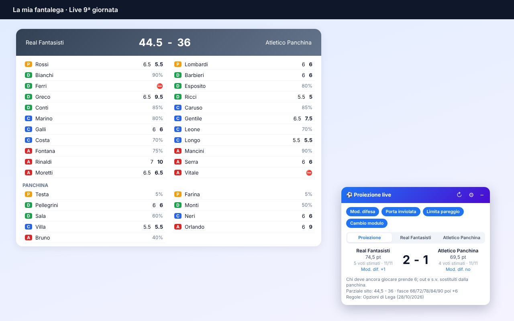

# Fantalega Live Predictor

Estensione per Chrome che, sulle pagine **live** di Leghe Fantacalcio, calcola il risultato che verrebbe fuori se tutti i giocatori che devono ancora scendere in campo prendessero **6**.

> Progetto indipendente, non affiliato né approvato da Fantacalcio S.r.l. "Fantacalcio" è un marchio dei rispettivi proprietari.



## Cosa fa
- **Proiezione del risultato**: punti e gol di entrambe le squadre, con le fasce gol della tua lega.
- **Dettaglio giocatore per giocatore**: voto e fantavoto di chi ha giocato, 6 a chi deve giocare, chi entra dalla panchina e al posto di chi.
- **Sostituzioni automatiche**: prima pari ruolo, poi con cambio modulo (se attivo), fino al numero massimo di cambi.
- **Modificatore difesa** (con la tabella della lega), **porta inviolata**, **limita pareggio / limita vittoria / autogol**, ammonito senza voto.
- **Regole lette in automatico**: apri *Menu → Opzioni di Lega* e scorri *Sostituzioni*, *Calcolo* e *Modificatori*: le regole vengono salvate per quella lega.
- **Backup**: dall'ingranaggio puoi esportare/importare in un file JSON le regole di tutte le leghe.

## Installazione
**Da Chrome Web Store**: (link quando pubblicata).

**Manuale (sviluppatori)**
1. Scarica o clona il repository.
2. Apri `chrome://extensions`, attiva *Modalità sviluppatore*.
3. *Carica estensione non pacchettizzata* → seleziona la cartella `extension/`.

## Impostazioni e più PC
Le regole sono salvate con `chrome.storage.sync`: se sei collegato a Chrome con lo stesso account Google e la sincronizzazione delle estensioni attiva, le ritrovi sugli altri PC (con l'estensione installata dallo Store). In ogni caso puoi usare **Esporta / Importa backup**.

## Privacy
Nessun dato lascia il browser. Vedi [PRIVACY.md](PRIVACY.md).

## Struttura
```
extension/        codice dell'estensione (da zippare per lo Store)
  manifest.json
  content.js
  icons/
store/            testi e screenshot per la scheda dello Store
PRIVACY.md        informativa privacy
```

## Limiti noti
- Legge la struttura della pagina del sito: se il sito cambia, l'estensione va aggiornata.
- Modificatori diversi da quello di difesa (portiere, centrocampo, attacco, capitano…) non sono gestiti.

## Licenza
MIT, vedi [LICENSE](LICENSE).
